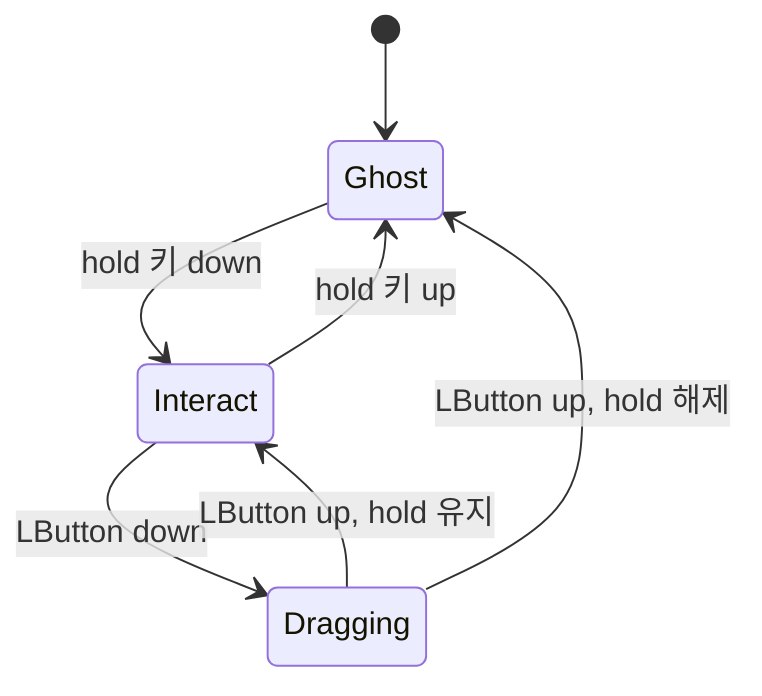

# GhostPiP — Master Technical Specification (v2.1)

> v2.0 대비 변경점: Native Messaging 브릿지, 엔진 기본 권한 `asInvoker`, Popover Top Layer 기반 In-Tab, `captureStream` 미러 기반 Document PiP, 창 제목 대신 rect 핸드셰이크로 PiP 탐지, 설정의 단일 소유권, 회피 불변식. 근거는 [spike/PHASE0_RESULTS.md](spike/PHASE0_RESULTS.md) 참고.

## 1. 개요
- **이름**: GhostPiP (고스트핍)
- **스토어 제목**: GhostPiP - 화면을 안 가리는 투명/클릭통과/자동회피 PIP / GhostPiP - Transparent, Click-Through & Auto-Dodge PiP
- **핵심**: 영상 PiP를 (1) 반투명, (2) 클릭 통과, (3) 커서 접근 시 자동 회피(금지 코너 지원)
- **플랫폼**: Chrome MV3 (`minimum_chrome_version: 116`) + Windows 10/11 엔진
- **대상 사이트**: YouTube, 치지직, SOOP(`play.sooplive.com`), Twitch. Netflix 등 DRM 사이트는 기본 PiP 폴백

## 2. 확정 결정
| 항목 | 결정 | 근거 |
|---|---|---|
| 확장 ↔ 엔진 연결 | **Native Messaging** (`chrome.runtime.connectNative`) | 정확한 확장 ID만 접속 가능, 열린 포트 없음, 연결이 열려 있는 동안 SW 유지 |
| 엔진 권한 | **`asInvoker`** (관리자 권한 불필요) | H4: 관리자 권한 게임 위에서도 `RegisterHotKey` 동작. Chrome 창 제어도 일반 권한으로 충분 |
| 엔진 언어 | **C# .NET 8 Native AOT** (Python은 Phase 0 실험 전용) | Win32 P/Invoke가 쉽고, 단일 exe, PyInstaller 백신 오진 회피 |
| In-Tab 플로팅 | **Popover Top Layer + `@layer ghostpip`** | H6: `position: fixed`는 4개 사이트 모두 실패, Popover는 모두 성공 |
| Document PiP 영상 | **`captureStream()` 미러**, DRM이면 기본 PiP | H5: 4개 사이트에서 원본을 건드리지 않고 재생됨 |
| Document PiP 채팅 | **사이트 팝아웃 채팅 URL을 iframe으로** | H5': YouTube에서 확인 |
| PiP 창 탐지 | **브라우저 프로세스 + TOPMOST + rect 핸드셰이크** | H3: Document PiP 창 제목은 원래 페이지의 제목을 따름 |
| Ghost 의미 | `clickThrough`와 `opacity`를 **독립 필드**로 둠 | 의미 중복 제거 |

## 3. 데이터 형태와 소유권

### 3.1 설정: `chrome.storage.local`이 유일한 기준
```ts
type Corner = "TL" | "TR" | "BL" | "BR";
type Axis = "free" | "vertical" | "horizontal";

interface Settings {
  clickThrough: boolean;            // Alt+G
  opacity: number;                  // 0.1..1.0, 기본 0.7
  dodge: {
    enabled: boolean;               // Alt+Shift+D
    axis: Axis;
    allowed: Corner[];              // 불변식: 3.3
    home: Corner;
    autoReturn: boolean;
    returnDelayMs: number;          // 기본 2500
    marginPx: number;               // 기본 20
    edgeInsetPx: number;            // 기본 16
    hoverDelayMs: number;           // 기본 100
    cooldownMs: number;             // 기본 300
    style: "move" | "fade";
    ignoreScreenEdgePx: number;     // 0 = 끔. RTS/MOBA 화면 가장자리 스크롤 대응
  };
  hotkeys: { clickThrough: string; dodge: string; mute: string; hold: "Ctrl+Alt" | "Ctrl+Shift" };
}
```
- 팝업과 엔진 핫키 모두 **의도(intent)**만 보냅니다. `background.js`가 이를 `Settings`에 반영하고, 저장한 뒤, 콘텐츠 스크립트와 엔진에 `STATE`를 브로드캐스트합니다.
- 엔진은 연결이 끊긴 동안 마지막 `STATE`를 캐시해 두고 로컬에서 토글을 적용합니다. 다시 연결되면 확장 쪽 상태를 따릅니다.

### 3.2 프로토콜 (Native Messaging: 4바이트 길이 + UTF-8 JSON)
```ts
type ToEngine =
  | { v: 1; type: "STATE"; settings: Settings }
  | { v: 1; type: "PIP_OPENED"; tabId: number; kind: "native" | "document"; rect: Rect; dpr: number }
  | { v: 1; type: "PIP_CLOSED"; tabId: number };

type ToExtension =
  | { v: 1; type: "HELLO"; engineVersion: string; elevated: boolean }
  | { v: 1; type: "INTENT"; intent: "TOGGLE_CLICK_THROUGH" | "TOGGLE_DODGE" | "TOGGLE_MUTE" }
  | { v: 1; type: "PIP_BOUND"; tabId: number }
  | { v: 1; type: "PIP_LOST"; tabId: number; reason: string };

interface Rect { x: number; y: number; w: number; h: number }   // CSS px (DIP)
```
- 엔진은 수신 메시지를 스키마로 검증하고, 맞지 않으면 버립니다. 명령은 위 목록이 전부입니다. 파일, 프로세스, 임의 HWND를 다루는 명령은 만들지 않습니다.
- `v`가 다르면 `HELLO`를 받은 뒤 팝업에 엔진 업데이트를 안내합니다.

### 3.3 회피 불변식 (확장 JS와 엔진 C# 공통)
```ts
const PAIRS: Record<Axis, [Corner, Corner][]> = {
  free:       [["TL","TR"],["TL","BL"],["TL","BR"],["TR","BL"],["TR","BR"],["BL","BR"]],
  vertical:   [["TL","BL"],["TR","BR"]],
  horizontal: [["TL","TR"],["BL","BR"]],
};
const isValidDodge = (allowed: Corner[], axis: Axis, home: Corner) =>
  allowed.includes(home) && PAIRS[axis].some(([a, b]) => allowed.includes(a) && allowed.includes(b));
```
- 팝업에서 체크를 해제하면 불변식이 깨지는 경우 해제를 막습니다. 엔진은 수신 시점에 다시 검증합니다.
- 두 구현이 같은 동작을 하도록 `shared/dodge-vectors.json` 테스트 벡터를 함께 사용합니다.

## 4. 이원 모드
| | Mode 1: In-Tab (무설치) | Mode 2: Desktop (엔진) |
|---|---|---|
| 범위 | 현재 탭 안 | OS 전체 |
| 플로팅 | 원본 `<video>`에 `popover="manual"` + `showPopover()` | Chrome 기본 PiP / Document PiP 창 |
| 투명/클릭 통과 | CSS `opacity`, `pointer-events: none` | `WS_EX_LAYERED` + `LWA_ALPHA`, `WS_EX_TRANSPARENT` |
| 단축키 | `chrome.commands` (Chrome 포커스 중) + 페이지 keydown | `RegisterHotKey` + `GetAsyncKeyState` |
| 회피 기준 영역 | 뷰포트 | 모니터 `rcWork` (전체화면 게임이면 `rcMonitor`) |

## 5. 확장 프로그램 (`extension/`)

### 5.1 권한
```jsonc
{
  "manifest_version": 3,
  "minimum_chrome_version": "116",
  "permissions": ["storage", "scripting", "nativeMessaging"],
  "host_permissions": [
    "https://*.youtube.com/*", "https://chzzk.naver.com/*",
    "https://*.sooplive.com/*", "https://*.sooplive.co.kr/*", "https://*.twitch.tv/*"
  ],
  "commands": {
    "_execute_action": {},
    "toggle-click-through": { "suggested_key": { "default": "Alt+G" } },
    "toggle-dodge":         { "suggested_key": { "default": "Alt+Shift+D" } },
    "toggle-mute":          { "suggested_key": { "default": "Alt+M" } }
  }
}
```
- `chrome.commands`의 추천 단축키는 최대 4개이며, 현재 구성으로 한도를 모두 씁니다.
- Alt+D는 Chrome의 주소창 단축키이므로 쓰지 않습니다.

### 5.2 In-Tab 플로팅 규칙 (H6 검증)
1. 원본 `<video>`를 DOM에서 떼어내거나 옮기지 않습니다.
2. 대상에 `popover="manual"`과 `.ghostpip-float` 클래스를 붙이고 `showPopover()`를 호출합니다.
3. 스타일은 `@layer ghostpip { … !important }`로 주입합니다. 레이어 안의 `!important`는 레이어 밖에 있는 사이트의 `!important`보다 우선합니다(SOOP에서 확인).
4. 컨트롤러는 Shadow DOM host로 만들고, 이것도 popover로 지정해 **영상보다 나중에** `showPopover()`합니다(Top Layer 안에서는 나중에 연 것이 위에 표시됨).
5. 해제할 때는 `hidePopover()`를 호출하고 `popover` 속성과 클래스를 제거합니다.
6. Ctrl+Alt 상태는 `blur`와 `visibilitychange`에서 초기화합니다(keyup 유실 대비).

### 5.3 Document PiP (Streamer Mode)
- **트리거**: 영상 위 Shadow DOM 버튼 클릭에서만 호출합니다. 팝업 버튼은 그 버튼을 강조 표시하는 역할만 합니다. user activation이 없으면 `NotAllowedError`가 납니다(H3'').
- **영상**: `pipVideo.srcObject = original.captureStream()`, `pipVideo.muted = true`. 소리는 원본에서 나옵니다. `captureStream()`이 예외를 던지거나 DRM(`video.mediaKeys !== null`)이면 `original.requestPictureInPicture()`로 폴백합니다.
- **채팅**: `selectors.json`의 `chatPopoutUrl` 템플릿으로 iframe을 만듭니다.
- **엔진 연동**: 창이 열리면 `PIP_OPENED { rect: {pipWindow.screenX, screenY, outerWidth, outerHeight}, dpr }`를 보냅니다. 기본 PiP는 `enterpictureinpicture` 이벤트에서 `PictureInPictureWindow`의 크기를 보냅니다.

### 5.4 `config/selectors.json`
```jsonc
{
  "schema": 1,
  "sites": {
    "youtube": { "match": "^https://www\\.youtube\\.com/watch", "video": "video.html5-main-video",
                 "chatPopoutUrl": "https://www.youtube.com/live_chat?is_popout=1&v={videoId}",
                 "idFrom": { "param": "v" } },
    "chzzk":   { "match": "^https://chzzk\\.naver\\.com/live/", "video": "video.webplayer-internal-video",
                 "chatPopoutUrl": "https://chzzk.naver.com/live/{channelId}/chat",
                 "idFrom": { "pathIndex": 2 } },
    "soop":    { "match": "^https://play\\.sooplive\\.com/", "video": "video.af_video", "chatPopoutUrl": null },
    "twitch":  { "match": "^https://www\\.twitch\\.tv/[^/]+$", "video": "video",
                 "chatPopoutUrl": "https://www.twitch.tv/popout/{channel}/chat",
                 "idFrom": { "pathIndex": 1 } }
  }
}
```
- 번들 파일이 기본값이고, 원격 갱신은 같은 스키마의 **데이터만** 받습니다(MV3 원격 코드 금지). 스키마 검증에 실패하면 번들 값을 씁니다.
- 선택자가 아무것도 찾지 못하면 "가장 큰, 재생 중인 `<video>`"로 폴백합니다.

### 5.5 `background.js`
- 시작할 때(`onStartup`, `onInstalled`) `connectNative("app.ghostpip.engine")`를 시도합니다.
  - 성공: 포트를 계속 열어 둡니다(SW 유지). 상태 배지는 `Engine Active`.
  - 실패(호스트 없음): In-Tab 모드로 동작하고, 팝업에 엔진 다운로드 배너를 띄웁니다.
- `INTENT: TOGGLE_MUTE` → `chrome.tabs.update(pipTabId, { muted: !muted })`.
- `tabs.onRemoved`로 PiP를 연 탭이 닫히면 `PIP_CLOSED`를 보냅니다.

## 6. 엔진 (`engine/`, C# .NET 8 Native AOT)

### 6.1 실행과 등록
- Chrome이 Native Messaging Host로 직접 실행합니다. 인스톨러는 `HKCU\Software\Google\Chrome\NativeMessagingHosts\app.ghostpip.engine`에 매니페스트 경로를 등록합니다(`allowed_origins`에 확장 ID 하나만). Edge, Whale, Brave도 각 브라우저 경로에 함께 등록합니다.
- exe 매니페스트: `requestedExecutionLevel=asInvoker`, `dpiAwareness=PerMonitorV2`.
- stdin이 EOF가 되면 모든 PiP 창의 스타일을 원복한 뒤 종료합니다.
- 트레이 아이콘: 상태, 긴급 해제(모든 스타일 원복), 종료.

### 6.2 스레드 모델
| 스레드 | 역할 |
|---|---|
| UI (STA) | 메시지 루프, `RegisterHotKey`, `SetWinEventHook`, 30ms 타이머, 트레이. **모든 상태를 이 스레드가 소유** |
| IO | stdin 읽기 → UI 스레드로 메시지 전달 / stdout 쓰기 큐 |

### 6.3 PiP 창 추적 (H3 반영)
1. 후보 조건: 클래스 `Chrome_WidgetWin_1`, 보이는 창, 프로세스 이름이 `chrome.exe`/`msedge.exe`/`whale.exe`/`brave.exe` 중 하나, `WS_EX_TOPMOST`, 가로·세로 150px 이상.
2. `PIP_OPENED`를 받으면 `rect × dpr`과 `GetWindowRect`가 ±4px 안에서 맞는 후보에 바인딩합니다. 맞는 후보가 없으면 500ms 동안 다시 시도한 뒤 `PIP_LOST`를 보냅니다.
3. 창 생성·파괴·이동은 `SetWinEventHook(EVENT_OBJECT_SHOW | EVENT_OBJECT_DESTROY | EVENT_OBJECT_LOCATIONCHANGE)`로 받습니다. 30ms마다 `EnumWindows`를 돌리지 않습니다.
4. 창 제목으로 판별하지 않습니다(Document PiP는 원래 페이지 제목을 따르고, 기본 PiP는 로케일마다 다름).

### 6.4 Ghost 적용 (H1/H2/H7 검증)
- 반투명: `WS_EX_LAYERED` + `SetLayeredWindowAttributes(LWA_ALPHA)`. 기본 PiP와 Document PiP 모두 깜빡임 없이 정상 합성됨.
- 클릭 통과: `WS_EX_TRANSPARENT` 추가. 클릭은 뒤 창으로 전달되고 PiP는 포커스를 가져가지 않음.
- 매 틱마다 ex-style 비트를 검사하고, 기대값과 다를 때만 `SetWindowLongPtr`와 `SetLayeredWindowAttributes`를 호출합니다(멱등). 창을 옮겨도 Chrome은 스타일을 되돌리지 않았습니다.
- 해제(종료, 긴급 해제, 바인딩 해제)는 `WS_EX_LAYERED | WS_EX_TRANSPARENT`를 제거하는 것으로 충분합니다(H7).
- 클릭 통과 상태에서 클릭하면 뒤 창이 활성화됩니다. 그 창이 항상 위 창이면 PiP를 덮을 수 있으므로, Ghost 적용 중에는 z-order를 확인해 PiP를 항상 위 그룹의 맨 위로 유지합니다(`SWP_NOACTIVATE`).

### 6.5 Hold-to-Interact 상태 머신

- Interact와 Dragging 상태에서는 `WS_EX_TRANSPARENT`를 해제하고 회피를 멈춥니다.
- Dragging이 끝나면 가장 가까운 코너로 스냅하고, 그 코너가 허용된 코너면 `home`을 갱신합니다.
- hold 키와 마우스 버튼 상태는 `GetAsyncKeyState`로 읽습니다.
- **제약 (H4'/H8)**: 관리자 권한 창이 포커스를 가진 동안에는 일반 권한 엔진이 수정 키 상태를 관찰할 수 없습니다(`GetAsyncKeyState`, Raw Input, LL 훅 모두 0회). 이때는 **Alt+G(클릭 통과 토글)**로 조작합니다. 한 번 PiP를 클릭하면 포커스가 Chrome으로 넘어가 Hold 감지가 다시 동작합니다.
- 팝업 팁과 엔진 `HELLO` 이후 안내에 이 제약을 표시합니다: "관리자 권한 게임 위에서는 Ctrl+Alt 대신 Alt+G로 조작 모드를 켜고 끄세요."

### 6.6 회피 솔버 (순수 함수)
입력: 커서 위치, 창 Rect, 작업 영역, `Settings.dodge`, 현재 코너, 시간 상태 → 출력: `Stay | MoveTo(corner) | Fade`
1. 커서가 숨겨져 있으면(`GetCursorInfo`의 `CURSOR_SHOWING` 플래그가 0, FPS 게임 플레이 중) → `Stay`.
2. `ignoreScreenEdgePx`가 0보다 크고 커서가 모니터 가장자리 안쪽 그 거리 이내에 있으면 → `Stay`.
3. 커서가 Rect + `marginPx` 안에 `hoverDelayMs` 이상 머물렀고, 마지막 이동 후 `cooldownMs`가 지났으면:
   - 후보 = 허용된 코너 ∩ 축 제약 ∩ {그 위치의 Rect + 마진이 커서를 포함하지 않는 코너}
   - 후보 중 **커서에서 가장 먼** 코너 → `MoveTo`. 후보가 없거나 `style == "fade"`면 → `Fade`.
4. `autoReturn`이 켜져 있고 현재 코너가 `home`이 아닐 때, 커서가 home 위치의 Rect + 마진 밖에 `returnDelayMs` 동안 머물렀으면 → `MoveTo(home)`.
- 작업 영역은 `MonitorFromWindow(MONITOR_DEFAULTTONEAREST)`로 구한 모니터의 `rcWork`를 씁니다. 전경 창이 `rcMonitor` 전체를 덮고 있으면 `rcMonitor`를 씁니다.
- 이동은 `SetWindowPos(…, SWP_NOSIZE | SWP_NOACTIVATE | SWP_NOZORDER)`, 가장자리 여백은 `edgeInsetPx`.

### 6.7 전역 핫키
- 기본값: Alt+G(클릭 통과), Alt+Shift+D(회피), Alt+M(음소거 → `INTENT` 전송). 모두 재지정 가능합니다.
- `RegisterHotKey`가 실패하면(다른 앱이 선점) `HELLO` 이후 팝업에 충돌을 표시합니다.

## 7. 디렉터리 구조
```
GhostPIP/
├── SPEC.md
├── shared/dodge-vectors.json        # 회피 솔버 공통 테스트 벡터
├── extension/
│   ├── manifest.json
│   ├── background.js                # Native Messaging, Settings 소유, 의도 처리
│   ├── config/selectors.json
│   ├── content/{content.js, overlay.css, dodge.js}
│   └── popup/{popup.html, popup.css, popup.js}
├── engine/
│   ├── GhostPiP.Engine.csproj       # net8.0-windows, PublishAot
│   ├── app.manifest                 # asInvoker, PerMonitorV2
│   ├── Program.cs                   # 메시지 루프, 스레드 구성
│   ├── NativeMessaging.cs
│   ├── PipTracker.cs
│   ├── GhostStyle.cs
│   ├── DodgeSolver.cs
│   ├── HoldStateMachine.cs
│   ├── Hotkeys.cs
│   └── installer/                   # NativeMessagingHosts 등록, 코드 서명
└── spike/                           # Phase 0 일회성 실험 (배포 제외)
```

## 8. UI/UX
- **팝업 헤더**: 로고 + 배지(`In-Tab Mode` / `Engine Active`)
- **메인**: Click-Through 토글(Alt+G), Smart Dodge 토글(Alt+Shift+D), Opacity 슬라이더(10~100%, 기본 70%)
- **회피 설정(접이식)**: 2×2 코너 그리드(툴팁: "미니맵 위치의 코너를 해제하면 해당 위치로 피하지 않습니다"), Home 코너 지정, 축 모드, Auto-Return, 회피 스타일(이동/페이드)
- **팁**: "클릭 통과 중 Ctrl + Alt를 누르고 있으면 창을 마우스로 잡고 이동할 수 있습니다."
- **엔진 미설치 배너**: [GhostPiP Engine 다운로드 (PC 게임 오버레이 활성화)]
- **문제 해결 안내**: DRM 검은 화면(그래픽 가속 끄기), 게임은 테두리 없는 창모드 사용, 핫키 충돌 시 재지정

## 9. 마일스톤
| Phase | 내용 | 완료 기준 (실행 가능한 검증) |
|---|---|---|
| **0** | 위험 가정 실측 | ✅ 완료 — `spike/PHASE0_RESULTS.md` |
| **1** | 확장 코어: Popover In-Tab, Shadow DOM 컨트롤러, 회피 솔버(JS), Document PiP(미러 + 채팅) | ✅ 완료 — 단위 테스트 51/51, 4개 사이트 E2E 28/28 통과 (`test/e2e/run.mjs`) |
| **2** | 팝업, `Settings` 단일 소유, `chrome.commands` | ✅ 완료 — 단위 테스트 53/53, 팝업·콘텐츠 실시간 E2E 5/5 통과 (`test/e2e/popup.mjs`) |
| **3** | 엔진: 추적, Ghost, Hold 상태 머신, 회피 솔버(C#), 핫키 | ✅ 완료 — C# Native AOT (`GhostPiP.Engine.exe`), `--self-test` 벡터 39/39 및 5/5 스위트 통과 |
| **4** | Native Messaging 연동, 인스톨러, 코드 서명 | ✅ 완료 — `install.ps1`, Native Messaging 브릿지, Win32 OS PiP 통합 E2E 5/5 통과 (`test/e2e/engine.mjs`) |
